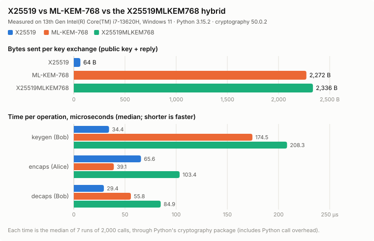

# Post-Quantum Key Exchange Lab

[](https://github.com/AccidentalSpaceMan/pq-key-exchange-lab/actions/workflows/tests.yml)

A hands-on lab for the key exchange that replaces today's quantum-vulnerable ones.

- **Part 1: ML-KEM-768, step by step.** The full FIPS 203 flow (key generation, encapsulate,
  decapsulate, matching shared secret), with real measured sizes and speeds compared with X25519.
- **Part 2: hybrid TLS.** A local TLS 1.3 server and client that negotiate **X25519MLKEM768**,
  the hybrid that Chrome, Firefox and Cloudflare use today. The lab *proves* the hybrid was used
  by reading the handshake bytes, and includes a small inspector for the server's certificate
  and handshake.

> **Status:** work in progress. Part 1 and Part 2 land in the next releases.

This is the third step of a portfolio series: learn the primitives
([crypto-primitive-playground](https://github.com/AccidentalSpaceMan/crypto-primitive-playground)),
inventory them ([crypto-inventory-scanner](https://github.com/AccidentalSpaceMan/crypto-inventory-scanner)),
then use the post-quantum replacements (this lab).

## Requirements

- **Python 3.15 or newer.** It is the first version whose built-in `ssl` module can choose and
  report the TLS key-exchange group.
- Python's `ssl` must be built with **OpenSSL 3.5 or newer**, which is the first to include
  X25519MLKEM768. The python.org installers for Windows and macOS include it, and so do recent
  Linux distributions such as Ubuntu 26.04.
- The [`cryptography`](https://cryptography.io/) package (installed automatically).

## Quick start

```bash
git clone https://github.com/AccidentalSpaceMan/pq-key-exchange-lab
cd pq-key-exchange-lab
python -m venv .venv
# Windows: .venv\Scripts\activate    macOS/Linux: source .venv/bin/activate
pip install -r requirements.txt

python -m pqlab env      # checks that this Python can run both parts
python -m pytest         # runs the tests
```

## Part 1: the ML-KEM-768 flow

```bash
python -m pqlab kem
```

A **KEM** (key encapsulation mechanism) lets two people end up with the same secret key over an
open channel. Think of a padlock box:

| Step | Who | FIPS 203 name | What happens | Size |
|---|---|---|---|---|
| 1 | Bob | `ML-KEM.KeyGen` | Makes an **encapsulation key** (public, an open padlock) and a **decapsulation key** (private, the only key that opens it) | public key 1184 B; private seed 64 B |
| 2 | Bob → Alice | | Sends the public key; anyone may see it | 1184 B |
| 3 | Alice | `ML-KEM.Encaps` | Picks fresh randomness, derives the **shared secret** from it, and locks it into a **ciphertext** with Bob's padlock | secret 32 B; ciphertext 1088 B |
| 4 | Alice → Bob | | Sends the ciphertext | 1088 B |
| 5 | Bob | `ML-KEM.Decaps` | Unlocks the ciphertext with his private key and gets the same 32-byte secret | 32 B |

The walkthrough checks that both secrets match (with a constant-time comparison) and that every
size matches FIPS 203. It also flips one bit of the ciphertext to show **implicit rejection**:
instead of an error that an attacker could learn from, Bob silently gets an unrelated random
secret, and the connection simply fails later.

**How this differs from X25519:** in X25519 both sides contribute a key and mix them together
(Diffie-Hellman). In a KEM only Alice chooses the secret and Bob recovers it. ML-KEM rests on
lattice maths ("module learning with errors") that no known quantum algorithm breaks, while
X25519 would fall to Shor's algorithm on a large quantum computer.

### Sizes and speed: ML-KEM-768 vs X25519



**Sizes** (bytes, read from real keys and ciphertexts, not copied from a table):

| Scheme | Public key (Bob sends) | Private key (stored) | Reply (Alice sends) | Shared secret | **On the wire** |
|---|---:|---:|---:|---:|---:|
| X25519 | 32 | 32 | 32 | 32 | **64** |
| ML-KEM-768 | 1,184 | 64 (seed) | 1,088 | 32 | **2,272** |
| X25519MLKEM768 (hybrid) | 1,216 | 96 | 1,120 | 64 | **2,336** |

**Speed** (microseconds per call, median of 7 runs × 2,000 calls; shorter is faster). Measured on
a 13th Gen Intel Core i7-13620H laptop, Windows 11, Python 3.15.2, `cryptography` 50.0.2:

| Scheme | keygen (Bob) | encaps (Alice) | decaps (Bob) | Total |
|---|---:|---:|---:|---:|
| X25519 | 34.4 | 65.6 | 29.4 | 129.4 |
| ML-KEM-768 | 174.5 | 39.1 | 55.8 | 269.3 |
| X25519MLKEM768 (hybrid) | 208.3 | 103.4 | 84.9 | 396.6 |

For X25519, "encaps" means Alice makes her own key pair and combines it with Bob's public key, and
"decaps" means Bob combines his private key with Alice's public key, so the three steps line up
with the KEM ones.

**What the numbers say, in plain terms:**

- **Size is the real cost.** A hybrid key exchange sends about **36 times** as many bytes as
  X25519 alone (2,336 vs 64). It still fits in a normal TLS handshake, but the browser's
  opening message (the ClientHello) grows by more than 1 KB and no longer fits in one network
  packet. Some old network boxes that assumed it would broke when browsers turned the hybrid on.
- **Speed is not a problem.** Every step takes well under a millisecond. ML-KEM is actually
  *faster* than X25519 for Alice's step (encaps), and the whole hybrid costs about 0.4 ms of CPU
  per connection, which is small next to the network round trip.
- **The hybrid costs roughly the sum of its parts**, because it simply runs both.

**A note on keygen:** these timings go through Python, so each one includes the cost of creating
Python objects. OpenSSL's own benchmark on the same laptop (`openssl speed -kem-algorithms
ML-KEM-768 X25519`, OpenSSL 3.5.7) measured ML-KEM-768 keygen at about 33 µs, encaps 18 µs and
decaps 27 µs, against X25519's 26, 62 and 31 µs. Encaps and decaps are close to the Python
numbers. Keygen through Python is about 5 times slower. We didn't dig into why, but keygen is
ML-KEM's slowest step in both measurements, so the conclusions above hold either way.

**Reproduce it** (your numbers will differ with your CPU; the sizes won't):

```bash
python -m pqlab bench                     # full run, about 15 seconds
python -m pqlab bench --quick             # rough run, about 1 second
python -m pqlab bench --from-json docs/bench-results.json --json "" --svg my-chart.svg   # redraw only
openssl speed -kem-algorithms ML-KEM-768 X25519    # native OpenSSL numbers, if you have OpenSSL 3.5+
```

The raw numbers behind the chart above are in [docs/bench-results.json](docs/bench-results.json).

## Safety

- Everything runs on your own machine. The TLS part only talks to a server it starts itself on
  `127.0.0.1`.
- Keys and certificates are made fresh at run time and never written into the repository
  (`.gitignore` blocks `*.pem`, `*.key` and similar files).
- No hand-written cryptography: ML-KEM and X25519 come from the `cryptography` package, and TLS
  comes from Python's `ssl` module (OpenSSL).

## License

[MIT](LICENSE)
